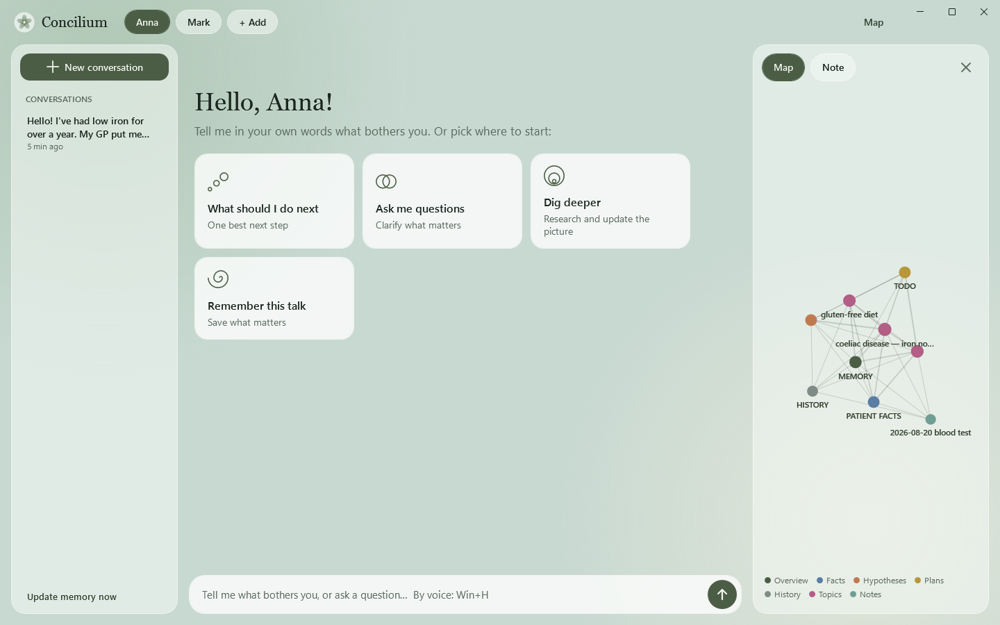
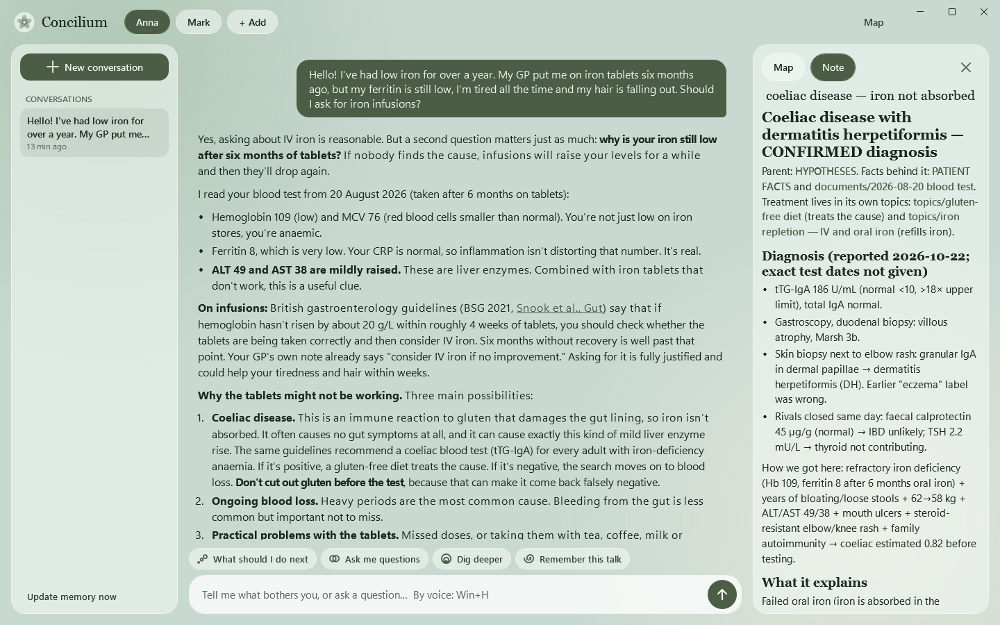
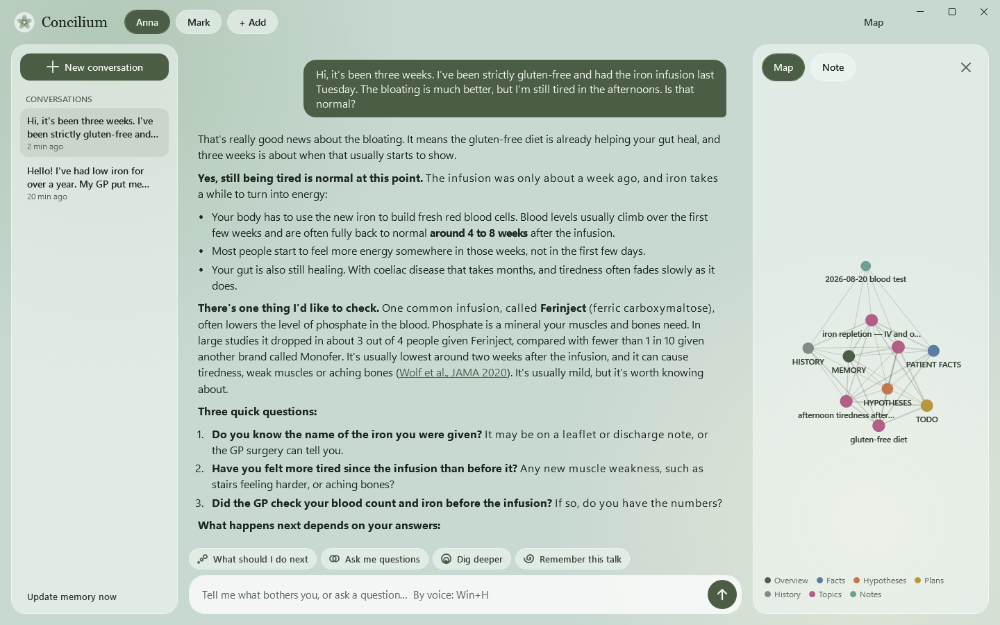
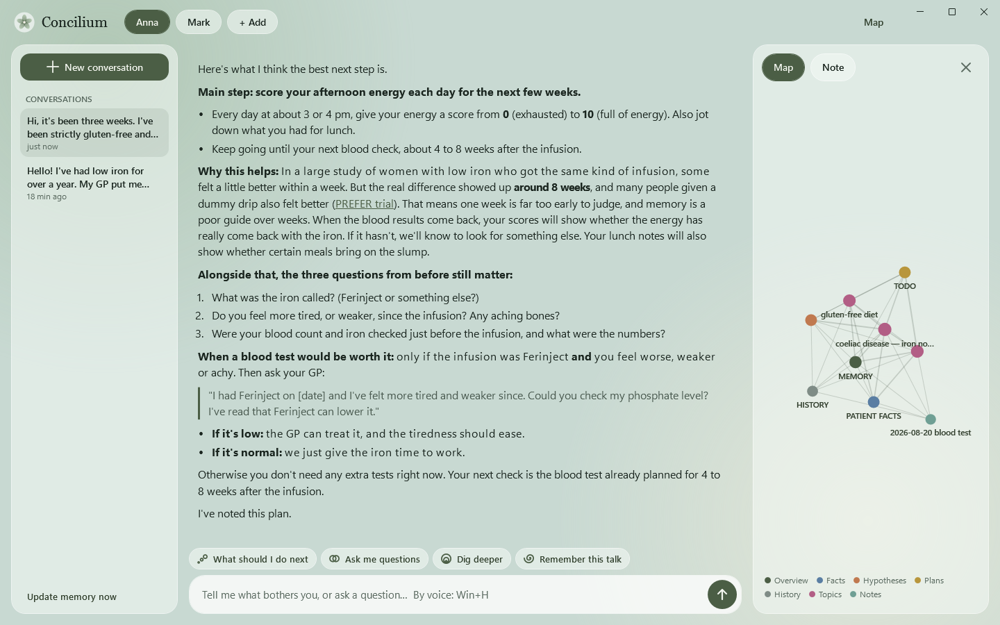

<p align="center"></p>

<h1 align="center">Concilium</h1>

<p align="center">A health agent that keeps a long-term record of one person's health and helps decide what to do next.</p>

<p align="center"></p>
<p align="center"><sub>Start screen: four actions, conversations on the left, the person's notes as a map on the right.</sub></p>

Concilium is a desktop app for following a health problem over weeks and months. You describe what is going on in your own words. It records the facts, keeps several possible explanations with the evidence for and against each, and suggests one next step. In a later conversation it continues from what it already knows.

It runs locally on top of Claude Code, with your own Claude account. Each person's notes are a folder of markdown files on their computer.

How it works:

- **Memory.** After a conversation the notes are updated: facts with dates and sources, results with numbers, hypotheses, one note per hypothesis or treatment, plans and a history of decisions.
- **Next step.** A test is suggested only when it is clear which explanations it would separate and what each result would change. Red flags are checked first.
- **Interface.** A chat and four buttons: *What should I do next*, *Ask me questions*, *Dig deeper*, *Remember this talk*. It is meant for people who do not work with files or a terminal.

It is not a doctor and does not replace one. It helps to understand the situation and to prepare for an appointment.

<p align="center"></p>
<p align="center"><sub>First conversation. The agent reads the blood test in the person's folder and refers to its values. On the right, the note on the leading hypothesis with the results it is based on.</sub></p>

<table>
<tr>
<td width="50%"></td>
<td width="50%"></td>
</tr>
<tr>
<td>Three weeks later, a new conversation continues from the notes. After it, a note on the new complaint was added to the map.</td>
<td>Answer to <i>What should I do next</i>: one step, the reason for it, and when a test would be worth doing.</td>
</tr>
</table>

The person in the screenshots is fictional, a simulated patient from [`eval/`](eval/), shown over two conversations three weeks apart.

## Two ways to use it

- **The app** — a window with a chat, four buttons and a map of the notes. File names and the terminal are never shown.
- **[concilium-markdown](concilium-markdown/)** — the same agent as a folder of markdown files and skills, for people who already use Claude Code or Codex. No app needed.

Both share the same memory layout, principles and skills: the app is a shell around `concilium-markdown`.

## Repository

```
windows/              the Windows app: native WPF (.NET 8), talks to Claude Code directly
app/                  the older Electron app: local server over the Claude Agent SDK, web UI
concilium-markdown/   the folder template: AGENTS, MEMORY skeleton, principles, skills
eval/                 simulated patients with a hidden diagnosis, played by a second agent
docs/                 icon and screenshots
```

## Windows app

Native WPF on .NET 8. It runs the Claude Code binary in stream-json mode — no Node, no local server — and starts it ahead of time, so the first answer does not wait for Claude to boot. Conversations are Claude Code's own (`~/.claude/projects/...`).

```bash
cd windows
dotnet publish -c Release -r win-x64 --self-contained true -p:PublishReadyToRun=true -o ../dist/Concilium
```

The published folder holds `Concilium.exe` and the `concilium-markdown` template. Claude Code is not shipped with the app. It uses the Claude Code already on the computer (Anthropic's native installer in `~/.local/bin`, or npm). If there is none, the sign-in button first runs Anthropic's official installer (`irm https://claude.ai/install.ps1 | iex`) without showing a terminal, then signs in. `CONCILIUM_CLAUDE=<path to claude.exe>` overrides the lookup. App data goes to `Concilium data` next to the exe; run from `bin/` it goes to `%APPDATA%\Concilium`. `CONCILIUM_SHOT=<png>` saves a picture of the window and quits (smoke test, README images); it runs beside an open app window. With it: `CONCILIUM_DATA=<folder>` uses another list of people, `CONCILIUM_SHOT_SEND="message || /next-step"` sends messages first (`@last` opens the latest conversation), `CONCILIUM_SHOT_SCROLL=top` shows a conversation from its start, `CONCILIUM_SHOT_NOTE=<note>` opens a note on the right. The app speaks the Windows language (English if it has no strings for it); `CONCILIUM_LANG=en` overrides it.

## Run the older Electron app from source

Requires Node.js 20+ and a Claude account.

```bash
cd app
npm install
npm start
```

Then open http://localhost:4747. On Windows, `app/Concilium.cmd` starts the server hidden and opens an app window.

The Electron app is kept for reference. Its packaged builds (`npm run dist:win`) include the Claude Code binary from the Agent SDK, so they are not published.

App data (the list of people and their folders) is stored next to the program in `data/`; when run from a source checkout it goes to the user's app-data folder (`%APPDATA%\Concilium`, `~/Library/Application Support/Concilium`, `~/.config/Concilium`), so nobody's data ends up in the repository.

## License

The code in this repository is under the [MIT License](LICENSE).

Claude Code and the Claude Agent SDK are Anthropic's software under Anthropic's own terms. They are not part of this repository and are not shipped with the Windows app: each person installs Claude Code and signs in with their own Claude account.
